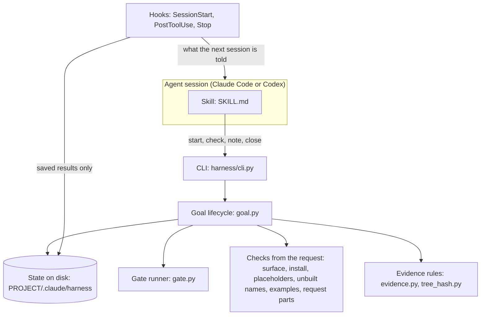
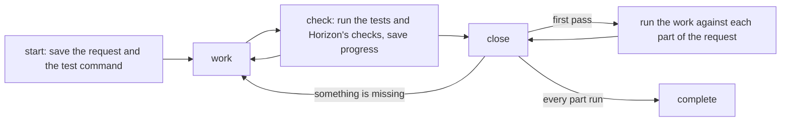

# Horizon: a long-horizon harness for AI coding agents

Horizon is a skill for Claude Code and Codex. It keeps one job on track across many
sessions, and it checks the work against the request before the job is called done.

An agent working on a long task loses its place when a session ends, and it tends
to stop when its own tests pass, whether or not the request is met. Horizon answers
both:

- **It keeps the job on disk.** The request, the test command, the progress notes
  and the next action are saved, and every new session is told where the last one
  stopped.
- **It checks the work from the request, not from the agent's code.** Before a goal
  can complete, every name the request gives must import, the package must install
  in a clean copy, no function may be a placeholder, and the agent must run the
  work against each part of the request.

It is about 10,500 lines of Python that use only the standard library. It needs no
extra model API, service or key.

## Result

Horizon was compared with plain Claude Code on 31 tasks from the E2E-SWE benchmark.
In each task the agent builds a Python library from a written specification, and
hidden tests grade the result. Both arms ran side by side on the same day with the
same model (Claude Haiku 5.5), prompt and limits: 15 model calls per session and up
to 10 sessions per build. The plan was frozen before the first build.

| Measure | Horizon | Plain Claude Code | Difference |
| --- | --- | --- | --- |
| Hidden tests passed (mean of 31 tasks, 2 builds each) | **86.9%** | 76.7% | **+10.2** (95% CI +2.3 to +21.5, p = 0.013) |
| Builds that scored zero | **2 of 62** | 10 of 62 | p = 0.015 |
| Input tokens | **407M** | 496M | 18% fewer |

Scope of the result:

- **The gain comes from preventing total failures,** such as a package that does not
  install or a module that does not import. On the 22 tasks where neither arm had a
  zero, the two were level (+1.0, not significant).
- **These are the tasks Horizon was developed on.** A held-out benchmark is the
  next step.
- **Only Claude Code was measured.** The Codex skill has not been through this
  benchmark.

The full record, with every task's score, is in
[docs/evaluations/e2eswe-big2.md](docs/evaluations/e2eswe-big2.md).

## Architecture



Horizon has four layers:

1. **The skill** is a 130-line instruction file. It tells the agent when to save,
   what each report means and what to do about it.
2. **The CLI** is one Python entry point that both runtimes call. Its commands
   print JSON.
3. **The core** holds the goal's lifecycle, the gate runner, the checks and the
   rules that decide whether a goal may complete.
4. **The state** is plain files in the project being worked on.

Hooks sit beside the session. They read the state and tell each new session where
the job stands.

### Design principles

- **Nothing lives in the conversation.** A session can end at any call, so every
  command reads the state from disk and writes it back. The next session needs no
  memory of the last one.
- **The checks come from the request.** They are written by `start`, before any
  code exists, from the request's own text. The agent's tests show that its code
  does what the agent expected. These checks show whether it does what was asked.
- **A result counts only for the files it ran on.** Every test result is saved with
  a fingerprint of the project's files. A pass on older files cannot complete a
  goal.
- **Completion is decided by the harness.** The agent asks with `close`. The
  harness answers "complete" or lists what is missing.
- **Hooks never run the project's code.** Claude Code runs hooks outside the
  sandbox it gives the agent's commands, so hooks read saved results only.
- **The skill stays general.** It carries no rule fitted to one benchmark or one
  kind of task, and a test guards that.
- **No dependencies.** The runtime is the Python standard library.

### The goal lifecycle



A **goal** is one request. It holds the request verbatim, a **gate** (the one
command that runs the work's tests), a budget of turns (20 by default) and an
optional time limit, checkpoints, notes and the next action.

| Command | What it does |
| --- | --- |
| `start` | Saves the goal, writes Horizon's checks from the request and runs the gate once as a baseline. |
| `check` | Runs the gate and Horizon's checks, and saves what was done and what comes next. |
| `note` | Saves a fact about the environment, or a finding left for later, without running anything. |
| `close` | Completes the goal when every check passes on the current files. Otherwise it says what is missing. |
| `reopen` | Carries a completed goal on when the same work is extended. |

### Checks taken from the request

`start` reads the request, and the Markdown files it names, and writes these
checks.

| Check | What it does | Effect on `close` | Module |
| --- | --- | --- | --- |
| Surface | Imports every module and public name the request gives. | Blocks | `surface.py` |
| Install | Copies the project, installs it offline in a throwaway environment the way the request says (a package install or the setup script it names), then imports it from another folder. | Blocks | `install_gate.py` |
| Placeholders | Reads the source for functions with no body, and for functions that hand out stubs. | Blocks | `stubs.py` |
| Baseline tests | Detects a change to a test the project had before the goal. | Blocks until a person approves | `evidence.py` |
| Unbuilt names | Lists names the request gives in code that no source file defines. | Reported | `unbuilt.py` |
| Spec examples | Runs the request's own code examples and compares the results it states. | Reported | `examples.py` |

Spec examples are reported and never block: a specification's examples are
sometimes wrong, and a blocking check would push correct code toward a wrong
example.

### The request check

A passing test suite means the agent's tests pass, not that the request is met. So
the first `close` that passes every check does not complete the goal.

1. `close` splits the request into numbered parts by its headings, and joins short
   sections so that a part is worth a pass. Each part is listed with its lines.
2. The agent runs the work the way each part describes and reads the result against
   the request's own words.
3. `check --parts` saves the parts that were run. One `check` saves no more parts
   than the tool calls made since the last save, so a part cannot be saved without
   work.
4. `close` completes when no part is left.

The list is kept in the goal's state, so the pass can span sessions.

### Evidence

`close` completes a goal only on recorded evidence, and `evidence.py` holds the
rules:

- **Fingerprint.** `tree_hash.py` hashes the content and mode of every file Git can
  see, tracked or not. Git's own state is left out, so a commit that changes no
  file changes nothing.
- **Coverage.** A gate result covers the current files only when its fingerprint
  matches theirs. `check` skips the gate when the files have not changed since the
  last run.
- **Baseline.** `start` records the project's test files. A goal cannot pass by
  editing a test it did not write.
- **Budget.** Each `check` uses one turn. When the budget is spent, `close` records
  the goal as finalized, not as complete.

### Hooks (Claude Code)

The first `start` in a project installs three hooks in the project's
`.claude/settings.json`. `uninstall-hooks` removes them.

- **SessionStart** shows the next action, the latest test result with the failing
  tests by name, the notes, the files changed since the last save, and what the
  checks still report.
- **PostToolUse** keeps the last thing a session said and ran, so a session cut off
  before `check` still hands on what it found.
- **Stop** completes a goal whose saved results already allow it. Otherwise it sends
  the session back to work once while the goal is active and has budget left.

A guard (`hookguard.py`) refuses to run the gate, the install check or the examples
while a hook is active. Those run only through commands the agent starts, inside
its sandbox.

Codex has no hooks. Its skill runs `status` at the start of a session instead.

### State on disk

All state belongs to the project being worked on, never to the checkout Horizon is
installed in. Several projects can share one installation.

```text
PROJECT/.claude/harness/            (.codex/harness for Codex)
├── goals/SLUG.json                 the goal: request, gate, budget, checkpoints, next action
├── gates/NAME/
│   ├── request.md                  the request, verbatim
│   ├── test_surface.py             one import test per name the request gives
│   ├── spec_examples.py            the request's own examples
│   └── examples_waived.json        examples skipped, each with the request line that says why
└── notes/
    ├── SLUG.md                     what the agent learned, part by part
    ├── surface-SLUG.json           the surface check's last result
    ├── install-SLUG.json           the install check's last result
    └── last-call.json              where the last session stopped
```

Each read-modify-write of a goal holds a file lock, and each write replaces the
file whole, so two sessions in one project do not lose each other's checkpoints.

### Modules

| Module | Role |
| --- | --- |
| [`cli.py`](harness/cli.py) | The entry point both runtimes call. |
| [`goal.py`](harness/goal.py) | The goal's lifecycle: start, check, note, close, reopen, and the request check. |
| [`gate.py`](harness/gate.py) | Runs the gate command with a timeout and records the result. |
| [`evidence.py`](harness/evidence.py) | Decides which result covers the current files and what still blocks completion. |
| [`tree_hash.py`](harness/tree_hash.py) | Fingerprints the project's files. |
| [`surface.py`](harness/surface.py) | Reads the names a request gives and writes the import test. |
| [`install_gate.py`](harness/install_gate.py) | The offline install check in a clean copy. |
| [`examples.py`](harness/examples.py) | Extracts and runs the request's code examples and signatures. |
| [`stubs.py`](harness/stubs.py) | Finds placeholder functions by reading the source. |
| [`unbuilt.py`](harness/unbuilt.py) | Finds names the request gives that no source file defines. |
| [`sections.py`](harness/sections.py) | Splits a request into the parts of the request check. |
| [`hooks.py`](harness/hooks.py), [`hookguard.py`](harness/hookguard.py) | The Claude Code hooks, and the guard that keeps them from running project code. |
| [`paths.py`](harness/paths.py), [`filelock.py`](harness/filelock.py) | Where the state lives, and safe concurrent writes. |
| [`reviewing.py`](harness/reviewing.py) | Requirement lines and reviewer verdicts (optional mode). |
| [`steps.py`](harness/steps.py), [`task_state.py`](harness/task_state.py), [`leases.py`](harness/leases.py) | State mode (optional, experimental). |

### Two runtimes, one implementation

Claude Code and Codex have separate skill instructions and separate state, backed
by the same Python code. Each skill's `scripts/harness.py` is a symlink to
`harness/cli.py`, and the skill passes its own `--runtime`.

| | Claude Code | Codex |
| --- | --- | --- |
| Skill in this checkout | [.claude/skills/horizon](.claude/skills/horizon) | [.agents/skills/horizon](.agents/skills/horizon) |
| Invocation | `/horizon` | `$horizon` |
| Project state | `.claude/harness` | `.codex/harness` |
| Hooks | SessionStart, PostToolUse, Stop | None |
| Measured on E2E-SWE | Yes | No |

## Use it

Open a project in the agent and ask for Horizon by name:

> Use horizon to build the library SPEC.md describes. Keep working until its tests
> pass and every part of the spec is met.

> Use horizon to finish this refactor. Stop after 30 minutes.

The skill finds its own helper and sets the goal up. To check the setup yourself,
run from this checkout:

```bash
python3 .claude/skills/horizon/scripts/harness.py --runtime claude doctor
python3 .agents/skills/horizon/scripts/harness.py --runtime codex doctor
```

For another project, pass `--project "/absolute/project/path"` before the
subcommand. The skill's location decides the implementation, and the working
project decides where the state lives.

In an unattended run, set `HORIZON_UNATTENDED=1` in the environment the agent
starts with. The Stop hook then sends an active goal back to work up to five times
a session, because no person will answer a question.

## Install for all your projects

It needs Python 3.10 or later on a POSIX system.

Keep the whole checkout at a stable location. The skill's entry point and CLI
reference are relative symlinks into the shared implementation, so copying only the
skill folder will not work. Link the skill into your agent's personal skill
directory:

```bash
REPO="/absolute/path/to/this/checkout"
mkdir -p "$HOME/.claude/skills" "$HOME/.agents/skills"
ln -s "$REPO/.claude/skills/horizon" "$HOME/.claude/skills/horizon"   # Claude Code
ln -s "$REPO/.agents/skills/horizon" "$HOME/.agents/skills/horizon"   # Codex
```

Run only the line for the agent you use. If `horizon` already exists there, look at
it first: these commands do not replace it. Claude Code gives a personal skill
precedence over a project skill of the same name, so do not keep two different
versions. See [Claude Code skills](https://code.claude.com/docs/en/skills) and
[Codex skills](https://learn.chatgpt.com/docs/build-skills).

## Optional modes

The default goal is thin: a request, a gate and the checks above. These are also
available, and none of them was part of the measured run.

- **Requirement lines and an independent reviewer.** A goal started with a
  `requirements.md` or with `--review` gets a numbered requirement list, and a fresh
  reviewer answers each line before `close` completes.
- **Coverage goals.** `start --coverage` reviews an artifact against a criterion
  when no command can check it.
- **State mode (experimental).** Each increment goes to a fresh worker that gets
  only a saved state packet, not the conversation.

The [CLI reference](docs/harness-cli.md) covers all three.

## Limits

- **Checkpoints make resuming possible; they do not wake anything up.** An agent
  still has to start a session and continue the goal.
- **The checks read Python.** The surface, install, placeholder and example checks
  apply to Python packages. For other work Horizon still keeps the goal, the gate
  and the request check.
- **The gate covers only what its tests cover.** The request check is the agent
  reading its own results against the request, so it can miss what the agent
  misreads.
- **Notes and approvals record what the agent asserts.** They are not identity
  verification or a security sandbox.
- **State mode cannot tell whether a worker is still running.** If a session is
  killed while a worker holds an attempt, the next session must establish that the
  worker stopped before it runs `step-recover`.

## Development

```bash
python3 -m pytest -q
```

The suite has 1,180 tests and takes about seven minutes. The tests need pytest, and
the runtime has no third-party dependencies. They cover the goal's lifecycle, each
check, the evidence rules, the hooks, both runtime entry points and whole CLI
workflows.

More to read:

- [CLI reference](docs/harness-cli.md): every command, check and rule
- [Runtime separation results](docs/runtime-separation-results.md)
- Design documents: [specs](docs/superpowers/specs) and [plans](docs/superpowers/plans)

## Provenance

Horizon was split, with its filtered commit history, from
[continual-harness](https://github.com/deepanathanrajendiran-hub/continual-harness)
(archived), which held this skill and a companion skill together.
