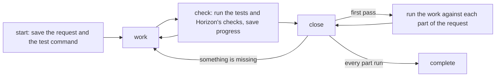

# Horizon: a long-horizon harness for AI coding agents

Horizon is a skill for Claude Code and Codex. It keeps one job on track across many
sessions, and it checks the work against the request before the job is called done.

An agent working on a long task loses its place when a session ends, and it tends
to stop when its own tests pass, whether or not the request is met. Horizon answers
both:

- **It keeps the job on disk.** The request, the test command, the progress notes
  and the next action are saved, and every new session is told where the last one
  stopped.
- **It checks the work from the request, not from the agent's code.** Before a goal
  can complete, every name the request gives must import, the package must install
  in a clean copy, no function may be a placeholder, and the agent must run the
  work against each part of the request.

It is about 10,500 lines of Python that use only the standard library. It needs no
extra model API, service or key.

## Result

Horizon was compared with plain Claude Code on 31 tasks from the E2E-SWE benchmark.
In each task the agent builds a Python library from a written specification, and
hidden tests grade the result. Both arms ran side by side on the same day with the
same model (Claude Haiku 5.5), prompt and limits: 15 model calls per session and up
to 10 sessions per build. The plan was frozen before the first build.

| Measure | Horizon | Plain Claude Code | Difference |
| --- | --- | --- | --- |
| Hidden tests passed (mean of 31 tasks, 2 builds each) | **86.9%** | 76.7% | **+10.2** (95% CI +2.3 to +21.5, p = 0.013) |
| Builds that scored zero | **2 of 62** | 10 of 62 | p = 0.015 |
| Input tokens | **407M** | 496M | 18% fewer |

Both primary measures favour Horizon, so by the plan's rule it beat the plain agent
on this run. What the result does and does not show:

- **The gain comes from preventing total failures.** Six of the plain agent's ten
  zeros were a missing or failing setup script, which the install check catches. On
  the 22 tasks where neither arm had a zero, the two were level (+1.0, not
  significant).
- **The size of the gain depends on the day.** The plain agent scored 6.7 points
  lower than in an earlier run of the same tasks. Against that earlier run the lead
  would be about +3.5.
- **These are the tasks Horizon was developed on.** On the 10 tasks not studied
  since the previous run, the lead was +3.5 and not significant. A held-out
  benchmark is the next step.
- **Only Claude Code was measured.** The Codex skill has not been through this
  benchmark.

The full record, with every task's score, is in
[docs/evaluations/e2eswe-big2.md](docs/evaluations/e2eswe-big2.md).

### How it got here

| Date | Version | Tasks | Horizon − plain | What followed |
| --- | --- | --- | --- | --- |
| 2026-11-02 | Original design (requirement lists, reviewer agents) | 94 | **−1.7** (p = 0.034), at half the tokens | It led for five sessions, then closed goals early with gaps. The design was cut down to a thin core. |
| 2026-11-10 | Thin, version 3 | 31 × 2 | +3.7 (p = 0.20), 41% fewer tokens | Not significant, so no win was claimed. Fourteen more versions followed. |
| 2026-11-14 | Thin, version 17 (this code) | 31 × 2 | **+10.2** (p = 0.013) | Described above. |

Earlier designs also showed no gain on EvoCode-Bench and NL2Repo.

## How it works



A **goal** is one request. It holds the request verbatim, a **gate** (the one
command that runs the work's tests), a budget of turns (20 by default) and an
optional time limit, checkpoints, notes and the next action.

| Command | What it does |
| --- | --- |
| `start` | Saves the goal, writes Horizon's checks from the request and runs the gate once as a baseline. |
| `check` | Runs the gate and Horizon's checks, and saves what was done and what comes next. |
| `note` | Saves a fact about the environment, or a finding left for later, without running anything. |
| `close` | Completes the goal when every check passes on the current files. Otherwise it says what is missing. |
| `reopen` | Carries a completed goal on when the same work is extended. |

### Checks taken from the request

`start` reads the request, and the Markdown files it names, and writes these checks
before any code exists.

| Check | What it does | Effect on `close` |
| --- | --- | --- |
| Surface | Imports every module and public name the request gives. | Blocks |
| Install | Copies the project, installs it offline in a throwaway environment the way the request says (a package install or the setup script it names), then imports it from another folder. | Blocks |
| Placeholders | Finds functions with no body, and functions that hand out stubs. | Blocks |
| Baseline tests | Detects a change to a test the project had before the goal. | Blocks until a person approves |
| Unbuilt names | Lists names the request gives in code that no source file defines. | Reported |
| Spec examples | Runs the request's own code examples and compares the results it states. | Reported |

Spec examples are reported and never block: on real libraries about a quarter of a
specification's examples disagree with the released code, so a blocking check would
push correct code toward a wrong example.

### The request check

A passing test suite means the agent's tests pass, not that the request is met. So
the first `close` that passes every check does not complete the goal. It lists the
request's parts by number, each with its lines. The agent runs the work the way each
part describes, reads the result against the request, and saves the parts it ran
with `check --parts`. `close` completes when no part is left. The list is kept on
disk, so the pass can span sessions.

### Hooks (Claude Code)

The first `start` in a project installs three hooks in the project's
`.claude/settings.json`. `uninstall-hooks` removes them.

- **SessionStart** shows the next action, the latest test result with the failing
  tests by name, the notes, the files changed since the last save, and what the
  checks still report.
- **PostToolUse** keeps the last thing a session said and ran, so a session cut off
  before `check` still hands on what it found.
- **Stop** completes a goal whose saved results already allow it. Otherwise it sends
  the session back to work once while the goal is active and has budget left.

**No hook runs the project's code.** Claude Code runs hooks outside the sandbox it
gives the agent's commands, so hooks read saved results only. The gate, the install
check and the examples run through commands the agent starts.

Codex has no hooks. Its skill runs `status` at the start of a session instead.

## Use it

Open a project in the agent and ask for Horizon by name:

> Use horizon to build the library SPEC.md describes. Keep working until its tests
> pass and every part of the spec is met.

> Use horizon to finish this refactor. Stop after 30 minutes.

The skill finds its own helper and sets the goal up. To check the setup yourself,
run from this checkout:

```bash
python3 .claude/skills/horizon/scripts/harness.py --runtime claude doctor
python3 .agents/skills/horizon/scripts/harness.py --runtime codex doctor
```

For another project, pass `--project "/absolute/project/path"` before the
subcommand. The skill's location decides the implementation, and the working
project decides where the state lives.

| | Claude Code | Codex |
| --- | --- | --- |
| Skill in this checkout | [.claude/skills/horizon](.claude/skills/horizon) | [.agents/skills/horizon](.agents/skills/horizon) |
| Invocation | `/horizon` | `$horizon` |
| Project state | `.claude/harness` | `.codex/harness` |
| Hooks | SessionStart, PostToolUse, Stop | None |
| Measured on E2E-SWE | Yes | No |

In an unattended run, set `HORIZON_UNATTENDED=1` in the environment the agent
starts with. The Stop hook then sends an active goal back to work up to five times
a session, because no person will answer a question.

## Install for all your projects

It needs Python 3.10 or later on a POSIX system.

Keep the whole checkout at a stable location. The skill's entry point and CLI
reference are relative symlinks into the shared implementation, so copying only the
skill folder will not work. Link the skill into your agent's personal skill
directory:

```bash
REPO="/absolute/path/to/this/checkout"
mkdir -p "$HOME/.claude/skills" "$HOME/.agents/skills"
ln -s "$REPO/.claude/skills/horizon" "$HOME/.claude/skills/horizon"   # Claude Code
ln -s "$REPO/.agents/skills/horizon" "$HOME/.agents/skills/horizon"   # Codex
```

Run only the line for the agent you use. If `horizon` already exists there, look at
it first: these commands do not replace it. Claude Code gives a personal skill
precedence over a project skill of the same name, so do not keep two different
versions. See [Claude Code skills](https://code.claude.com/docs/en/skills) and
[Codex skills](https://learn.chatgpt.com/docs/build-skills).

## Optional modes

The default goal is thin: a request, a gate and the checks above. These are also
available, and none of them was part of the measured run.

- **Requirement lines and an independent reviewer.** A goal started with a
  `requirements.md` or with `--review` gets a numbered requirement list, and a fresh
  reviewer answers each line before `close` completes.
- **Coverage goals.** `start --coverage` reviews an artifact against a criterion
  when no command can check it.
- **State mode (experimental).** Each increment goes to a fresh worker that gets
  only a saved state packet, not the conversation.

The [CLI reference](docs/harness-cli.md) covers all three.

## Limits

- **Checkpoints make resuming possible; they do not wake anything up.** An agent
  still has to start a session and continue the goal.
- **The checks read Python.** The surface, install, placeholder and example checks
  apply to Python packages. For other work Horizon still keeps the goal, the gate
  and the request check.
- **The gate covers only what its tests cover.** The request check is the agent
  reading its own results against the request, so it can miss what the agent
  misreads.
- **Notes and approvals record what the agent asserts.** They are not identity
  verification or a security sandbox.
- **State mode cannot tell whether a worker is still running.** If a session is
  killed while a worker holds an attempt, the next session must establish that the
  worker stopped before it runs `step-recover`.

## Repository layout

| Path | What it holds |
| --- | --- |
| [harness/](harness) | The implementation. `cli.py` is the entry point, `goal.py` the goal's lifecycle and `hooks.py` the Claude Code hooks. `surface.py`, `install_gate.py`, `examples.py`, `stubs.py`, `unbuilt.py` and `sections.py` are the checks. |
| [.claude/skills/horizon](.claude/skills/horizon) | The Claude Code skill: a 130-line `SKILL.md` and a full guide. |
| [.agents/skills/horizon](.agents/skills/horizon) | The Codex skill. |
| [docs/harness-cli.md](docs/harness-cli.md) | Every command, check and rule, each with the run that led to it. |
| [docs/evaluations](docs/evaluations) | The benchmark record. |
| [tests/](tests) | 1,180 tests. |

## Development

```bash
python3 -m pytest -q
```

The tests need pytest, and the runtime has no third-party dependencies. The full
suite takes about seven minutes.

The fixes behind this version follow the same steps:

1. Find the root cause in a build that went wrong.
2. Write a regression test, and prove that it fails on the commit before the fix.
3. Replay a change to a check offline over the saved builds and requests, to see
   what else it would have flagged.
4. Run the full suite.

The skill text carries no rule fitted to one benchmark, and a test guards that.

More to read:

- [CLI reference](docs/harness-cli.md)
- [Runtime separation results](docs/runtime-separation-results.md)
- Design history: [specs](docs/superpowers/specs) and [plans](docs/superpowers/plans)

## Provenance

Horizon was split, with its filtered commit history, from
[continual-harness](https://github.com/deepanathanrajendiran-hub/continual-harness)
(archived), which held this skill and a companion skill together. That repository
keeps the earlier evaluation records.
